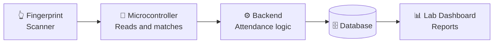

<div align="center">


<br/>

<a href="https://github.com/DinithMadushan?tab=followers"></a>


</div>

<br/>

<table>
<tr>
<td width="42%" align="center" valign="middle">


</td>
<td width="58%" valign="top">

### 🖥️ `about.js`

```js
const dinith = {
  role:       "Software Engineering Undergraduate",
  building:   "Fingerprint Lab Attendance System",
  learning:   ["Java", "Go", "C++", "Python"],
  focus:      ["OOP", "System Design", "Embedded + Web"],
  lookingFor: ["Open-source collabs", "Research projects"],
  funFact:    "I turn complex ideas into working software 🚀"
};
```

💬 **Ask me about:** Python · Software Development · Research · System Design

🤝 **Need help with:** System architecture, AI projects, large-scale design

</td>
</tr>
</table>

---

## 🔥 Currently Building

<div align="center">


</div>

A lab attendance system that identifies students by **fingerprint** instead of paper sign-in sheets. A student scans a finger, the system matches it, and the attendance is logged automatically.



<details>
<summary><b>🗺️ Roadmap (click to expand)</b></summary>

- [ ] Fingerprint enrollment (register students)
- [ ] Fingerprint matching and verification
- [ ] Attendance logging per lab session
- [ ] Admin dashboard and attendance reports
- [ ] Export reports (CSV / PDF)

> ✏️ Tick the boxes as you finish each step. Edit the list to match your real plan.

</details>

---

## 📚 Learning Journey

<div align="center">

| Language | Focus | Progress |
|:--|:--|:--|
| ☕ **Java** | OOP, collections, design patterns | `▰▰▰▱▱▱▱▱` |
| 🐹 **Go** | Concurrency, APIs, backend services | `▰▰▱▱▱▱▱▱` |
| ⚙️ **C++** | Memory, STL, systems and embedded | `▰▰▱▱▱▱▱▱` |
| 🐍 **Python** | OOP, automation, scripting | `▰▰▰▰▰▱▱▱` |

<sub>✏️ Progress bars are placeholders. Change the ▰ / ▱ counts as you improve.</sub>

</div>

---

## 🚀 Featured Projects

<table>
<tr>
<td colspan="2" valign="top">

### 🔐 Fingerprint Lab Attendance System &nbsp; 
`Fingerprint` `Embedded` `Backend` `Dashboard`

Biometric lab attendance: scan, match, log and report.

[](https://github.com/DinithMadushan?tab=repositories)

</td>
</tr>
<tr>
<td width="50%" valign="top">

### 🏫 Campus System
`Python` `OOP`

Students, Courses (Degree / Diploma / Certificate), Employees (Academic / Non-Academic), plus salary and average calculators.

[](https://github.com/DinithMadushan/designed-LMS)

</td>
<td width="50%" valign="top">

### 🛰️ Satellite Tracker
`3D` `Visualization`

Satellite tracking and 3D visualization system.

[](https://github.com/DinithMadushan?tab=repositories)

</td>
</tr>
<tr>
<td colspan="2" valign="top">

### 🏠 Boarding Finder &nbsp; 
`Web` `Team Project`

Web app that helps students find boarding places near campus.

[](https://github.com/DinithMadushan?tab=repositories)

</td>
</tr>
</table>

---

## 💻 Tech Stack

<div align="center">

**Languages**<br/>


**Web**<br/>


**Databases & Tools**<br/>
<br/>


</div>

---

## 📊 GitHub Stats

<div align="center">


</div>

<details>
<summary><b>🏆 More stats and trophies (click to expand)</b></summary>
<br/>
<div align="center">


</div>
</details>

---

## 🐍 Contribution Snake

<div align="center">
<picture>
  <source media="(prefers-color-scheme: dark)" srcset="https://raw.githubusercontent.com/DinithMadushan/DinithMadushan/output/github-snake-dark.svg"/>
  
</picture>
</div>

---

## 🌐 Let's Connect

<div align="center">

[](https://www.linkedin.com/in/dinith-madushan-a33972312/)
[](https://www.facebook.com/dinith.madushan.12)
[](https://discord.gg/ZUqaKKWapn)
[](https://reddit.com/user/DM_Supreme)
[](https://mastodon.social/@DinithMadushan)
[](mailto:dinithmadushan38@gmail.com)

<br/>

*Code with purpose, design with clarity, and learn without limits.*

✨ **"Code. Learn. Build. Repeat."** ✨

⭐ If you like my work, drop a star on my repositories. It really motivates me!


</div>
